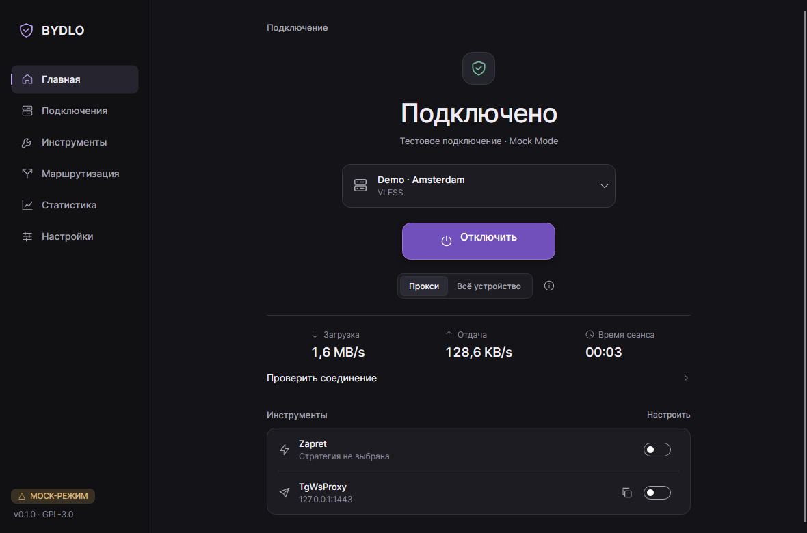
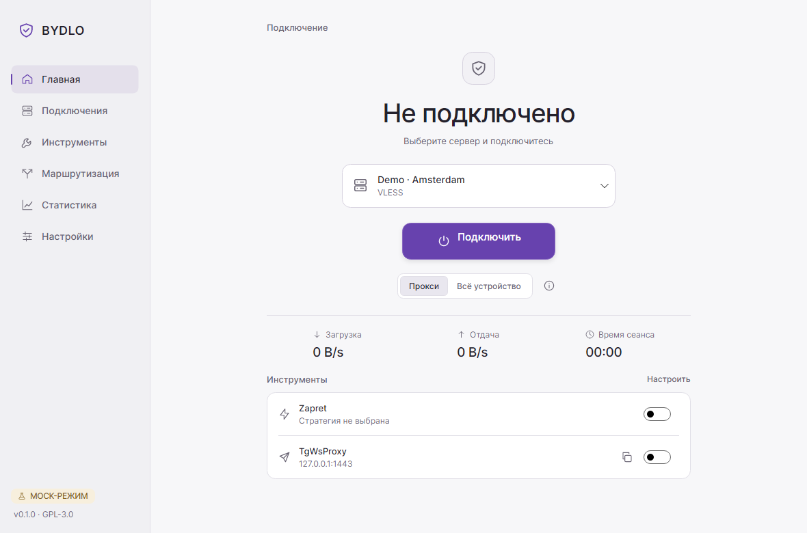
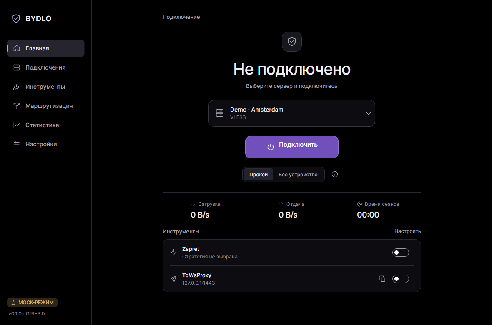
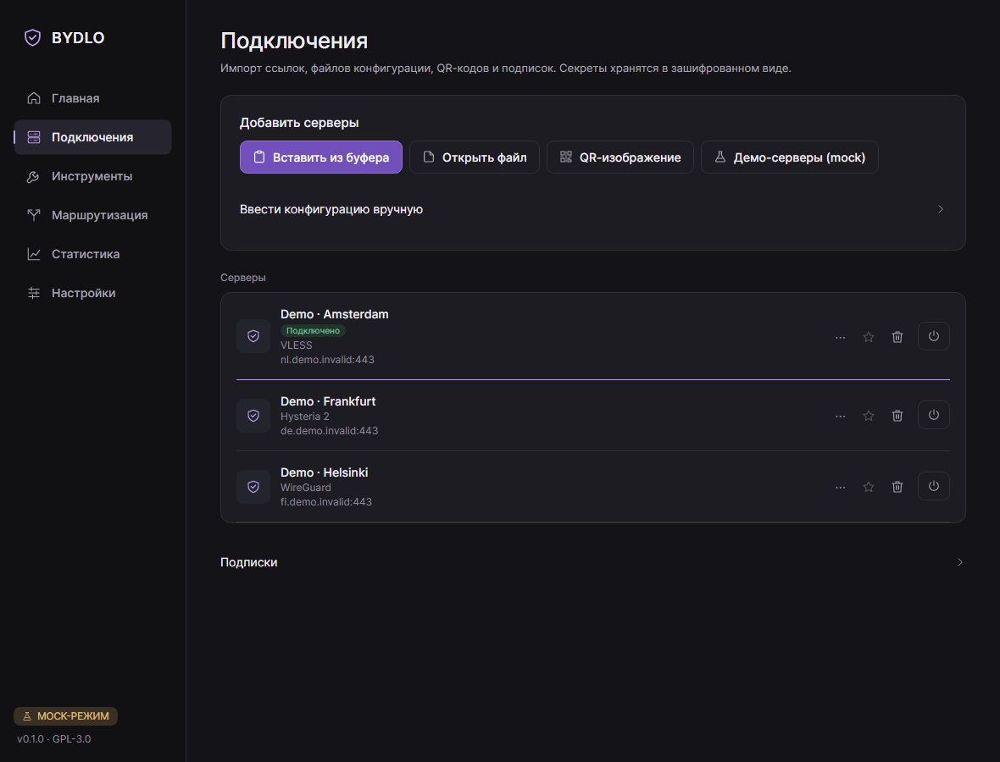
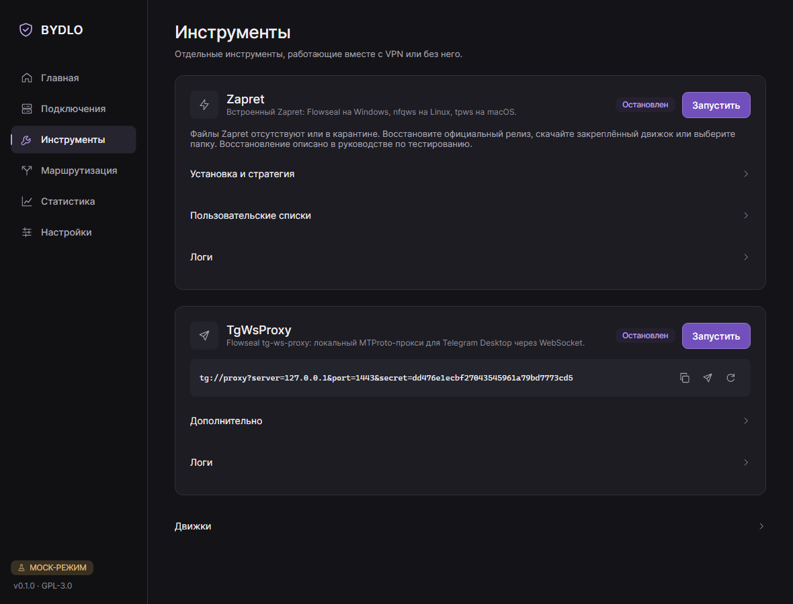
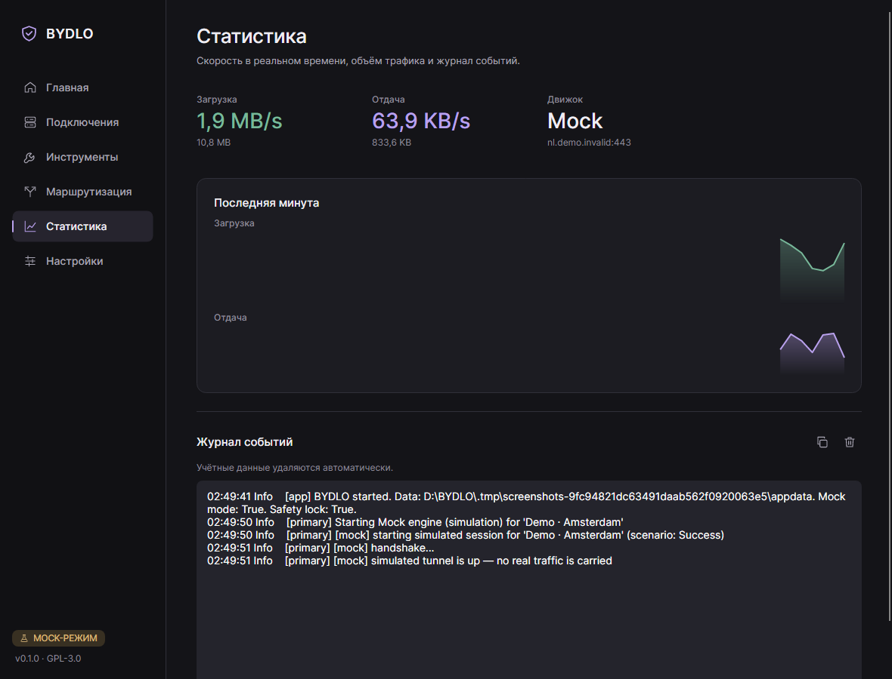
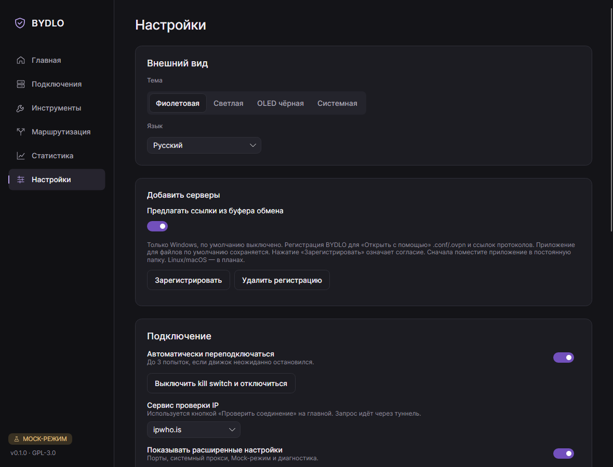
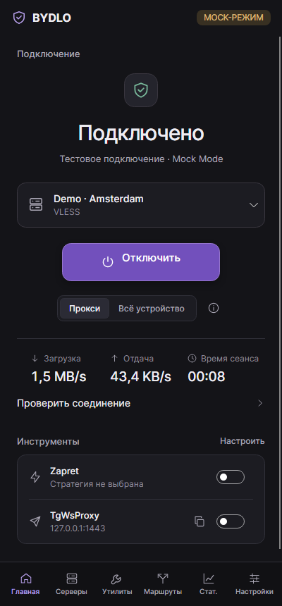
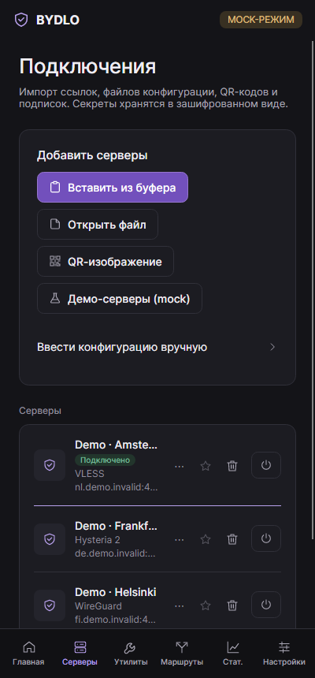

<p align="center"></p>

<h1 align="center">BYDLO</h1>
<p align="center"><b>B</b>ypass <b>Y</b>our <b>D</b>igital <b>L</b>imitations <b>O</b>nline<br>
<i>One app. Every protocol. Zero bullshit.</i></p>

<p align="center"></p>

BYDLO — бесплатный open-source лаунчер с графическим интерфейсом для VPN, прокси и инструментов свободного доступа к интернету.
Импортируйте ссылку, файл конфигурации, QR-код или подписку — и подключайтесь одной кнопкой.
BYDLO не изобретает протоколы заново: он управляет проверенными движками (sing-box, Xray-core, WireGuard,
AmneziaWG, OpenVPN), а также [Zapret](https://github.com/Flowseal/zapret-discord-youtube) и
[tg-ws-proxy](https://github.com/Flowseal/tg-ws-proxy) от Flowseal — через один понятный интерфейс.

> **Статус: v0.1 — первая публичная версия.** Приложение собирается, его логика покрыта изолированными тестами,
> для агентских проверок интерфейса используется явный Mock-режим. Реальные туннели авторы **ещё не проверили** на всех платформах —
> см. [docs/COMPATIBILITY.md](docs/COMPATIBILITY.md) и [docs/TESTING.md](docs/TESTING.md).

## Возможности

- **Подключение одной кнопкой**: заметная кнопка подключения, скорость в реальном времени и таймер сеанса.
- **Проверка соединения**: внешний IP, страна и задержка через туннель — по явному нажатию, с выбором сервиса проверки.
- **Протоколы:** VLESS (включая REALITY и XHTTP через Xray), VMess, Trojan, Shadowsocks, Hysteria 2, TUIC, SOCKS5, HTTP(S),
  WireGuard, AmneziaWG, OpenVPN.
- **Импорт:** ссылки (`vless://`, `vmess://`, `trojan://`, `ss://`, `hy2://`, `tuic://`, `socks5://`, `wireguard://`…),
  base64-подписки, `.conf` (WireGuard / AmneziaWG), `.ovpn`, изображения с QR-кодом.
- **Zapret из коробки:** Windows x64 — Flowseal; Linux x64/ARM64 — nfqws + nftables; macOS — tpws + PF (IPv4 TCP 80/443). На Windows стратегии Flowseal используются без изменений, `winws.exe` запускается без окна консоли;
  выбор стратегии, игровой фильтр, редактор пользовательских списков, логи, встроенная закреплённая версия с проверкой SHA-256 в CI; пользовательские списки переживают обновления.
- **TgWsProxy:** встроенный порт tg-ws-proxy от Flowseal — без Python и установки, ссылка `tg://proxy` в один клик, управление секретом, контроль занятых портов.
- **Работа в фоне:** трей BYDLO с выбором сервера и управлением VPN/Zapret/TgWsProxy; настраиваемые автозапуск, подключение при старте и системные уведомления.
- **Маршрутизация:** локальный прокси или режим всего устройства (TUN), раздельное туннелирование, DNS,
  списки «напрямую / через туннель / блокировать», диапазоны mesh-VPN остаются вне туннеля.
- **Безопасность:** секреты хранятся зашифрованными (DPAPI на Windows), учётные данные вырезаются из логов,
  восстановление после сбоев, проверка целостности загружаемых движков, привилегированные операции изолированы и выключены по умолчанию.
- **Дизайн:** фиолетовая (по умолчанию), светлая, чёрная OLED и системная темы; русский и английский языки;
  спокойные непрозрачные поверхности, адаптивная раскладка от ширины телефона до десктопа.
- **Mock-режим для агентских проверок:** явно помеченная имитация подключения, трафика и ошибок для проверки интерфейса без запуска сетевых движков.

## Интерфейс

Фиолетовая, светлая и OLED-темы используют общую компоновку. На узком экране sidebar заменяется нижней навигацией.
Скриншоты сняты на русском языке в Mock Mode; подключение и трафик на них имитируются.

<p align="center">
  
  
</p>
<p align="center">
  
  
</p>
<p align="center">
  
  
</p>
<p align="center">
  
</p>
<p align="center">
  
  
</p>

## Платформы

| Платформа | v0.1 |
|---|---|
| Windows 10/11 x64, ARM64 | Собирается в CI; основная платформа разработки |
| Linux x64, ARM64 | Собирается в CI; встроенный nfqws, нужен root + nftables |
| macOS Intel, Apple Silicon | Собирается в CI (без подписи); встроенный tpws, только IPv4 TCP 80/443, нужен root |
| Android ARM64 | Запланирован (см. [roadmap](docs/ROADMAP.md)) |

Подробно по протоколам и платформам: [docs/COMPATIBILITY.md](docs/COMPATIBILITY.md).

## Быстрый старт (из исходников)

Для сборки нужны Git и .NET SDK 10.0.100 или новее в линейке 10.0 (см. `global.json`),
а также PowerShell или bash. Установите зависимости, клонируйте репозиторий и перейдите в его каталог.
На Linux нужны системные зависимости Avalonia (X11 и fontconfig).

**PowerShell — обычный пользовательский запуск:**

```powershell
git clone https://github.com/endercodezz/BYDLO.git
cd BYDLO
# Убрать флаги разработки только из текущей оболочки.
Remove-Item Env:BYDLO_MOCK, Env:BYDLO_SAFE_DEV, Env:BYDLO_DATA_DIR -ErrorAction SilentlyContinue
dotnet restore BYDLO.slnx
dotnet build BYDLO.slnx -c Release --no-restore
dotnet run --project src/Bydlo.Desktop -c Release --no-build
```

**bash — обычный пользовательский запуск:**

```bash
git clone https://github.com/endercodezz/BYDLO.git
cd BYDLO
unset BYDLO_MOCK BYDLO_SAFE_DEV BYDLO_DATA_DIR
dotnet restore BYDLO.slnx
dotnet build BYDLO.slnx -c Release --no-restore
dotnet run --project src/Bydlo.Desktop -c Release --no-build
```

В существующем checkout начните с очистки переменных. Для обычного запуска не загружайте `scripts/env.*`:
это окружение агента, включающее защиту от запуска реальных движков. Команды очистки выше предназначены
для ручного запуска сопровождающим; агент не выполняет их для проверки подключения.

Без явного выбора mock приложение использует реальные адаптеры. Импортируйте профиль, настройте нужный
движок в интерфейсе и подключитесь вручную. Возможности и необходимые права зависят от платформы:
см. [совместимость](docs/COMPATIBILITY.md). Сама сборка не проверяет реальное подключение.

- `--mock` и `BYDLO_MOCK=1` принудительно включают имитацию на текущий сеанс; отсутствие аргумента
  не отменяет переменную. Их значение не сохраняется как пользовательский выбор.
- Сохранённый переключатель «Настройки → Дополнительно → Mock-режим» тоже включает имитацию.
  Для реального подключения выключите его после удаления флагов; по умолчанию он выключен.
- `BYDLO_SAFE_DEV=1` блокирует реальные движки и привилегированные операции, но сам по себе не включает mock.
- `BYDLO_DATA_DIR` выбирает каталог данных; `scripts/env.*` задают `.tmp/appdata`.
  После удаления переменной используется обычный каталог данных пользователя с собственными сохранёнными настройками.
  Если нужен именно прежний каталог, сохраните эту переменную и проверьте в нём переключатель mock.

Сценарий агента с явным mock и изолированные проверки описаны в [docs/BUILD.md](docs/BUILD.md).

## Документация

- [Импорт, буфер обмена и «Открыть с помощью»](docs/IMPORT.md)
- [Архитектура](docs/ARCHITECTURE.md)
- [Сборка](docs/BUILD.md)
- [Совместимость протоколов и платформ](docs/COMPATIBILITY.md)
- [Руководство по ручному тестированию](docs/TESTING.md)
- [Roadmap](docs/ROADMAP.md)
- [Сторонние компоненты и лицензии](THIRD_PARTY_NOTICES.md)
- [Как помочь проекту](CONTRIBUTING.md)
- [Правила для ИИ-агентов](CLAUDE.md) (на английском)

## Как помочь

Проект открыт для всех: исправления, переводы, тесты на реальной сети, новые движки и документация.
Начните с [CONTRIBUTING.md](CONTRIBUTING.md) — там сборка, Mock-режим, правила сетевой безопасности и процесс
issue → ветка → PR. Задачи для первого вклада помечены
[`good first issue`](https://github.com/endercodezz/BYDLO/issues?q=is%3Aissue+is%3Aopen+label%3A%22good+first+issue%22).

## Благодарности

BYDLO построен на работе этих проектов:
[Flowseal/zapret-discord-youtube](https://github.com/Flowseal/zapret-discord-youtube),
[bol-van/zapret](https://github.com/bol-van/zapret),
[Flowseal/tg-ws-proxy](https://github.com/Flowseal/tg-ws-proxy),
[SagerNet/sing-box](https://github.com/SagerNet/sing-box),
[XTLS/Xray-core](https://github.com/XTLS/Xray-core),
[WireGuard](https://www.wireguard.com),
[AmneziaWG](https://github.com/amnezia-vpn),
[OpenVPN](https://github.com/OpenVPN/openvpn),
[Avalonia UI](https://github.com/AvaloniaUI/Avalonia) и других, перечисленных в [THIRD_PARTY_NOTICES.md](THIRD_PARTY_NOTICES.md).
Спасибо им.

## Лицензия

BYDLO распространяется по [GNU General Public License v3.0 или более поздней](LICENSE).
Сторонние компоненты сохраняют свои лицензии — см. [THIRD_PARTY_NOTICES.md](THIRD_PARTY_NOTICES.md).

Используйте BYDLO в соответствии с законодательством вашей страны. Это клиент для сетей и серверов, которыми вы вправе пользоваться.
