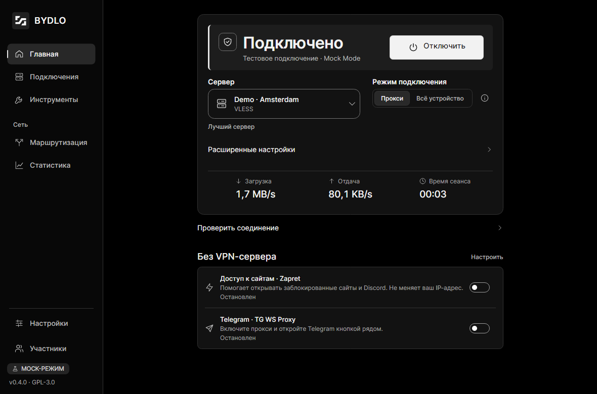
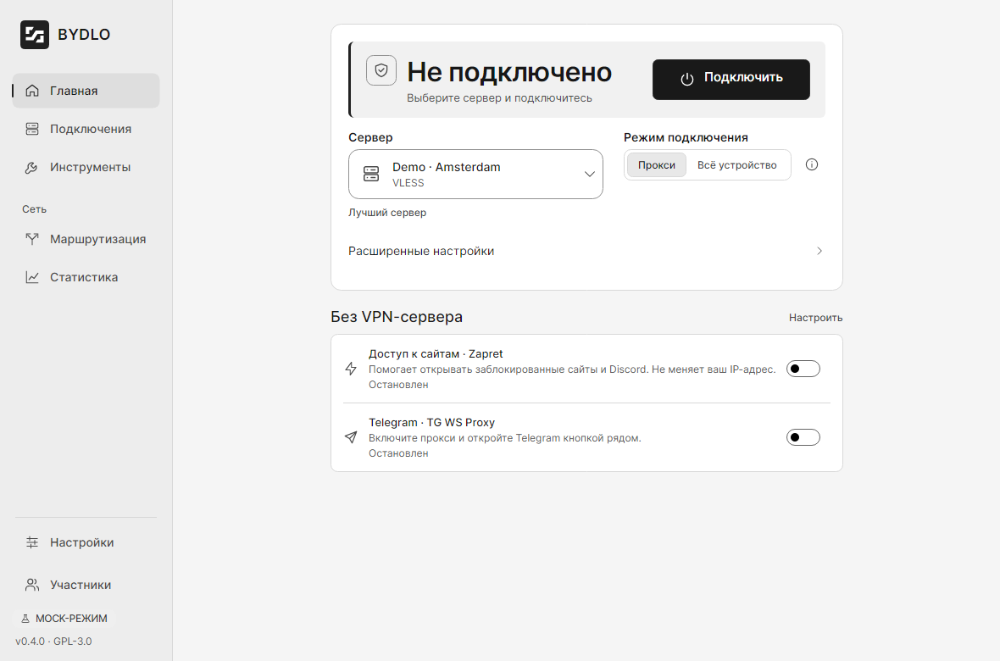
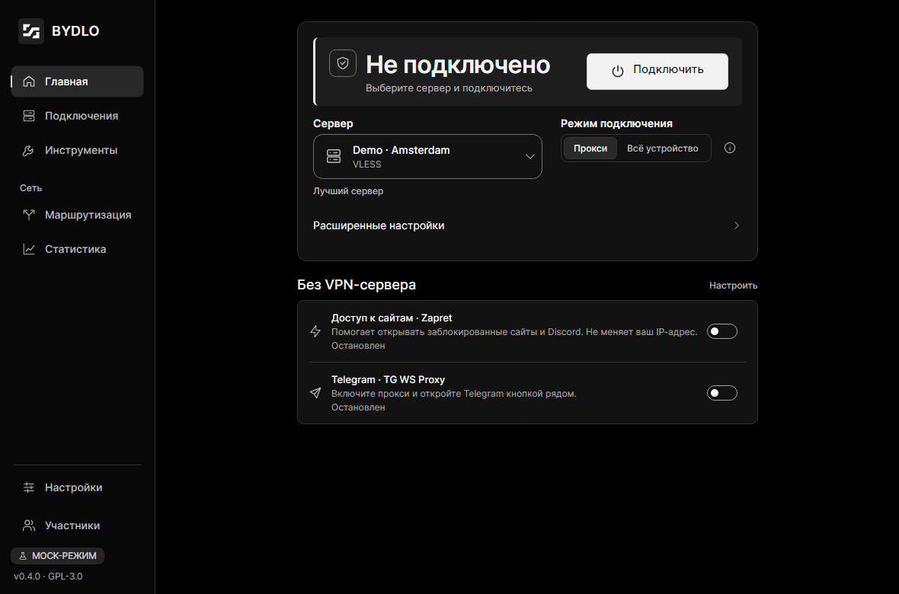
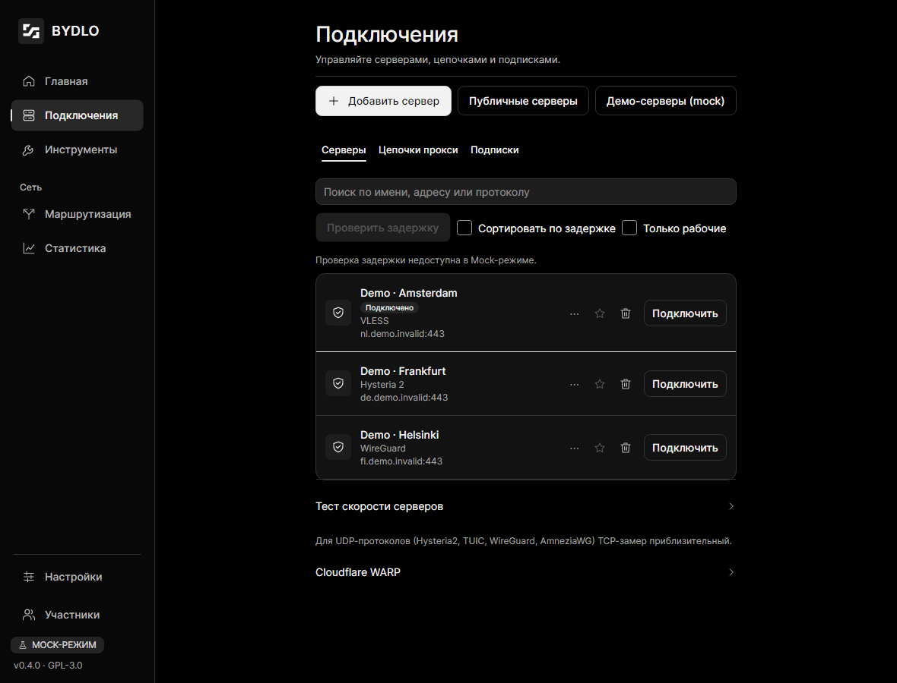
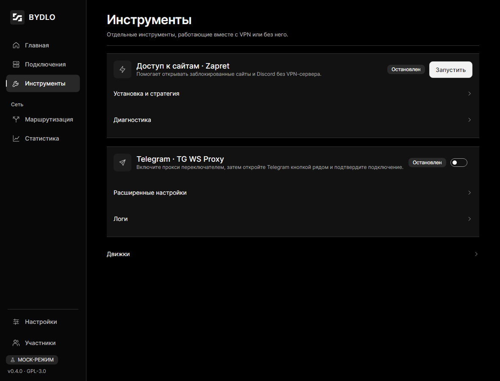
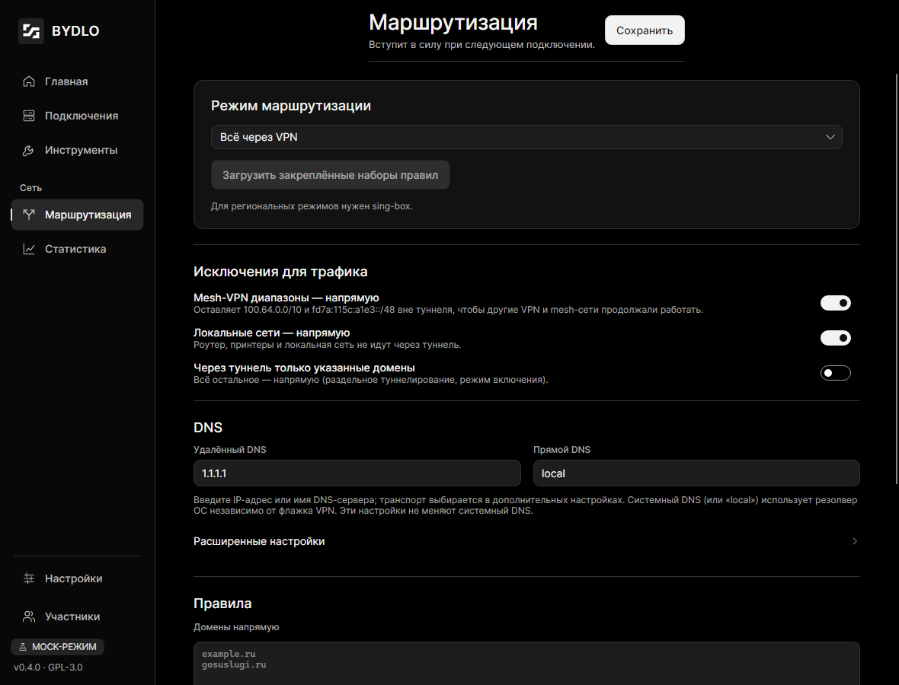
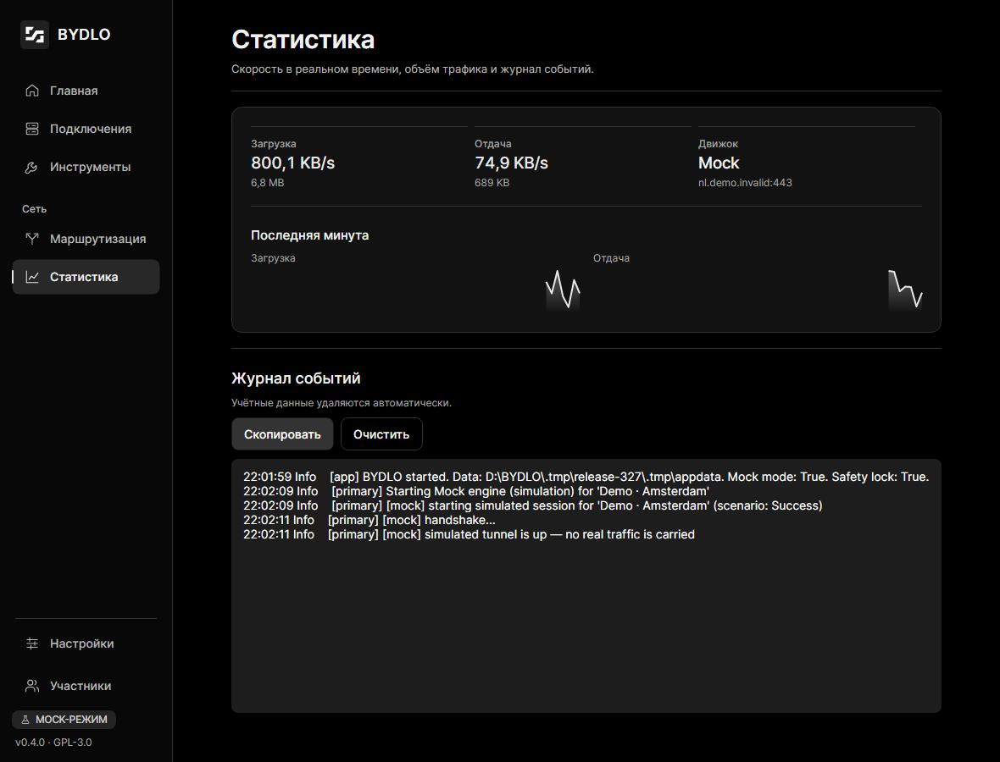
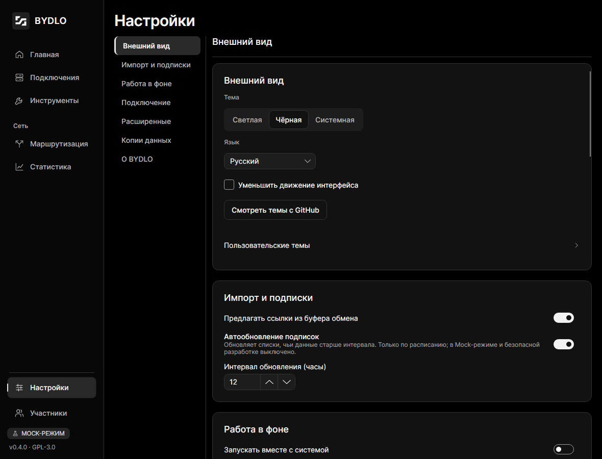
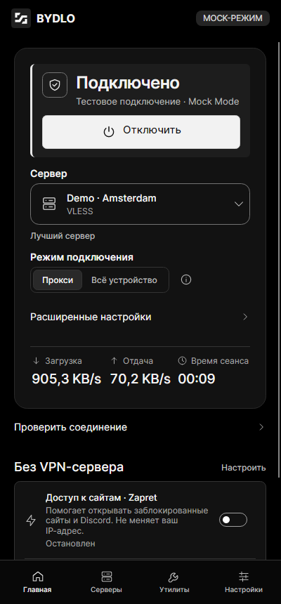
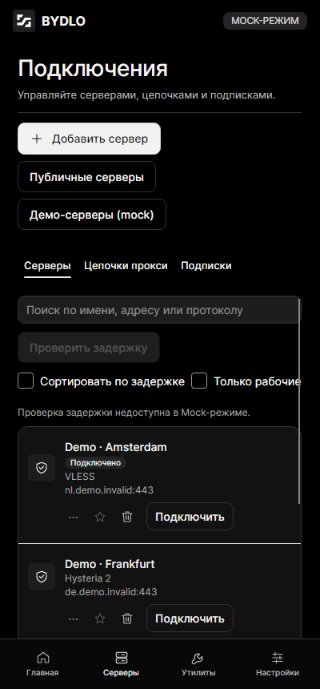

<p align="center"></p>

<h1 align="center">BYDLO</h1>
<p align="center"><b>B</b>ypass <b>Y</b>our <b>D</b>igital <b>L</b>imitations <b>O</b>nline<br>
<i>Одно приложение. Все протоколы.</i></p>

<p align="center"></p>

BYDLO — бесплатный open-source лаунчер с графическим интерфейсом для VPN, прокси и инструментов свободного доступа к интернету.
Импортируйте ссылку, файл конфигурации, QR-код или подписку — и подключайтесь одной кнопкой.
BYDLO не изобретает протоколы заново: он управляет проверенными движками (sing-box, Xray-core, WireGuard,
AmneziaWG, OpenVPN), а также [Zapret](https://github.com/Flowseal/zapret-discord-youtube) и
[tg-ws-proxy](https://github.com/Flowseal/tg-ws-proxy) от Flowseal — через один понятный интерфейс.

> **BYDLO v0.4.3** — подписанный каталог обновлений, отдельные согласия на обращения к GitHub, понятный способ обновления для каждого типа установки, OpenVPN 2.7.9 и быстрый журнал. [Скачать BYDLO](https://github.com/endercodezz/BYDLO/releases) · [Что нового](docs/RELEASE_NOTES.md#bydlo-v043).
> Статусы и ограничения платформ описаны в [матрице совместимости](docs/COMPATIBILITY.md), а порядок ручной проверки — в [руководстве](docs/TESTING.md).

## Возможности

- **Подключение одной кнопкой**: заметная кнопка подключения, скорость в реальном времени и таймер сеанса.
- **Проверка соединения**: внешний IP, страна и задержка через туннель — по явному нажатию, с выбором сервиса проверки.
- **Протоколы:** VLESS (включая REALITY и XHTTP через Xray), VMess, Trojan, Shadowsocks, Hysteria 2, TUIC, SOCKS5, HTTP(S),
  WireGuard, AmneziaWG, OpenVPN.
- **Импорт:** ссылки (`vless://`, `vmess://`, `trojan://`, `ss://`, `hy2://`, `tuic://`, `socks5://`, `wireguard://`…),
  base64-подписки, `.conf` (WireGuard / AmneziaWG), `.ovpn`, изображения с QR-кодом.
- **[Мастер добавления серверов](docs/IMPORT.md):** одна кнопка, выбор ссылки/подписки, файла или QR-кода,
  предпросмотр до сохранения и базовая форма ручного ввода.
- **[Резервная копия](docs/BACKUP.md):** зашифрованный паролем файл `.bydlobackup` с серверами, подписками, ключами доступа,
  настройками и маршрутизацией; предпросмотр импорта с объединением или заменой — в настройках.
- **Zapret из коробки:** Windows x64 — Flowseal; Linux x64/ARM64 — nfqws + nftables; macOS — tpws + PF (IPv4 TCP 80/443). На Windows стратегии Flowseal используются без изменений, `winws.exe` запускается без окна консоли;
  выбор стратегии, игровой фильтр, редактор пользовательских списков, логи, встроенная закреплённая версия с проверкой SHA-256 в CI; пользовательские списки переживают обновления.
- **TgWsProxy:** встроенный порт tg-ws-proxy от Flowseal — без Python и установки, ссылка `tg://proxy` в один клик, управление секретом, контроль занятых портов.
- **Движки в релизе:** sing-box и Xray на всех пяти платформах; AmneziaWG без клиента Amnezia на Windows/Linux; консольный OpenVPN. На Windows подписанный DCO устанавливается из BYDLO один раз с явным согласием, без OpenVPN GUI и служб.
- **Работа в фоне:** трей BYDLO с выбором сервера и управлением VPN/Zapret/TgWsProxy; настраиваемые автозапуск, подключение при старте и системные уведомления.
- **Маршрутизация:** локальный прокси или режим всего устройства (TUN), раздельное туннелирование, DNS,
  списки «напрямую / через туннель / блокировать», диапазоны mesh-VPN остаются вне туннеля.
- **Безопасность:** секреты хранятся зашифрованными (DPAPI на Windows), учётные данные вырезаются из логов,
  восстановление после сбоев, проверка целостности загружаемых движков, привилегированные операции изолированы и выключены по умолчанию.
- **Дизайн:** светлая, чёрная и системная (по умолчанию) темы, Purple, Dirty и другие темы из галереи; русский и английский языки;
  спокойные непрозрачные поверхности, адаптивная раскладка от ширины телефона до десктопа.
- **Mock-режим для агентских проверок:** явно помеченная имитация подключения, трафика и ошибок для проверки интерфейса без запуска сетевых движков.

## Интерфейс

Все темы используют общую компоновку. На узком экране sidebar заменяется нижней навигацией.
На главной доступны импорт, публичные серверы сообщества, Zapret и Telegram-прокси. Включите прокси Telegram переключателем, затем нажмите кнопку с бумажным самолётом. Галерея тем GitHub доступна в «Настройки → Внешний вид».
Технические параметры открываются через «Расширенные настройки». [Как пользоваться интерфейсом](docs/INTERFACE.md).
Скриншоты сняты на русском языке в Mock Mode; подключение и трафик на них имитируются.

<p align="center">
  
  
</p>
<p align="center">
  
  
</p>
<p align="center">
  
  
</p>
<p align="center">
  
</p>
<p align="center">
  
  
</p>

## Платформы

| Платформа | v0.4 |
|---|---|
| Windows 10/11 x64, ARM64 | Сборка в CI на GitHub. Zapret только на x64 |
| Linux x64, ARM64 | Сборка в CI на GitHub (x64 также на зеркале Gitea); встроенный nfqws, нужен root + nftables |
| macOS, только Apple Silicon | Сборка в CI на GitHub, без подписи. Встроенный tpws, только IPv4 TCP 80/443, нужен root |
| Android ARM64 | Запланирован (см. [roadmap](docs/ROADMAP.md)) |

Подробно по протоколам и платформам: [docs/COMPATIBILITY.md](docs/COMPATIBILITY.md).

Linux: flake для NixOS (`nix run github:endercodezz/BYDLO`), `.deb`, AppImage и PKGBUILD для Arch —
см. [docs/LINUX.md](docs/LINUX.md).

Нативные пакеты: Windows Setup/Portable, Linux AppImage/`.deb`, macOS `Setup.pkg`; упаковка и необходимые
секреты подписи описаны в [BUILD.md](docs/BUILD.md#нативные-пакеты-и-подпись-215).
В v0.4.3 подпись Windows/macOS временно пропущена: возможны предупреждения SmartScreen,
UAC и Gatekeeper. Для проверки файлов доступны SHA-256 и GitHub attestations.

### Кто обновляет вашу установку

BYDLO сам определяет, как он установлен, и показывает в «Настройки → О приложении» только тот
способ обновления, который действительно работает.

- **Windows Setup.exe, macOS Setup.pkg, Linux AppImage** — встроенное обновление. Включите
  «Автоматически обновлять BYDLO»: приложение проверяет и скачивает пакет при запуске,
  а устанавливает его только при полном выходе, после остановки всех подключений.
  По умолчанию выключено. Закрытие окна в трей выходом не считается, и подключение
  из-за обновления не перезапускается.
- **`.deb` для Debian/Ubuntu и пакеты Arch** — обновляет пакетный менеджер. Скачайте новый `.deb`
  из релиза и установите его через `apt` либо обновите пакет AUR. Репозиторий `apt` для BYDLO
  не настраивается, поэтому `apt upgrade` сам новые версии не найдёт.
- **Nix и NixOS** — обновляет Nix: `nix profile upgrade` или пересборка конфигурации.
- **Portable ZIP и старые ZIP-архивы** — вручную: полностью закройте BYDLO, замените всю папку
  новой версией и сохраните каталог данных. Автоматического перехода на установленную сборку нет.

Настройки, профили, подписки и ключи доступа лежат в пользовательском каталоге данных
и переживают любое обновление. Подробности по платформам — в [docs/LINUX.md](docs/LINUX.md).

Начиная с v0.4.2 публикуются девять пользовательских файлов:

- Windows x64: [Setup.exe](https://github.com/endercodezz/BYDLO/releases/latest/download/BydloDesktop-win-x64-Setup.exe), [Portable.zip](https://github.com/endercodezz/BYDLO/releases/latest/download/BydloDesktop-win-x64-Portable.zip).
- Windows ARM64: [Setup.exe](https://github.com/endercodezz/BYDLO/releases/latest/download/BydloDesktop-win-arm64-Setup.exe), [Portable.zip](https://github.com/endercodezz/BYDLO/releases/latest/download/BydloDesktop-win-arm64-Portable.zip).
- Linux x64: [AppImage](https://github.com/endercodezz/BYDLO/releases/latest/download/BydloDesktop-linux-x64.AppImage), [`.deb` amd64 в релизе](https://github.com/endercodezz/BYDLO/releases/latest).
- Linux ARM64: [AppImage](https://github.com/endercodezz/BYDLO/releases/latest/download/BydloDesktop-linux-arm64.AppImage), [`.deb` arm64 в релизе](https://github.com/endercodezz/BYDLO/releases/latest).
- macOS Apple Silicon: [Setup.pkg](https://github.com/endercodezz/BYDLO/releases/latest/download/BydloDesktop-osx-arm64-Setup.pkg).

У `.deb` версия входит в имя файла: `bydlo_<версия>_amd64.deb` / `_arm64.deb`.
Точные ссылки на все девять пакетов добавляются в описание каждого нового релиза.
`*-full.nupkg` и `releases.<RID>.json` — служебные файлы автообновления, вручную их скачивать не нужно.
`SHA256SUMS.txt` проверяется в одной папке со скачанными пакетами.
Старые релизы и ссылки на их ZIP остаются доступны.

## Что входит в полный релиз

Распаковывайте весь архив, сохраняя папку `engines` рядом с BYDLO. В комплект входят sing-box,
Xray и OpenVPN; AmneziaWG — на Windows/Linux; Zapret — на поддерживаемых платформах.
TgWsProxy встроен в само приложение: Python, pip и отдельный клиент Flowseal не нужны.
Скачивание sing-box/Xray из интерфейса остаётся запасным путём, а не обязательным первым шагом.

Клиенты Amnezia и OpenVPN не требуются. На Windows для OpenVPN нужно один раз явно установить
встроенный подписанный DCO и адаптер через «Инструменты → Движки» с правами администратора.
Для нативного WireGuard пока нужен официальный клиент; WireGuard через sing-box работает без него.
На Linux остаются системные зависимости TUN/DNS/firewall — см. матрицу совместимости.

Движки запускаются фоновыми процессами без собственного интерфейса и окон консоли;
TgWsProxy работает внутри BYDLO. Повышение прав пользователь подтверждает отдельно.
Обычная сборка из исходников не создаёт полный комплект движков: порядок упаковки,
проверки хешей и лицензий описан в [docs/BUILD.md](docs/BUILD.md#публикация).

## Быстрый старт (из исходников)

Для сборки нужны Git и .NET SDK 10.0.100 или новее в линейке 10.0 (см. `global.json`),
а также PowerShell или bash. Установите зависимости, клонируйте репозиторий и перейдите в его каталог.
На Linux нужны системные зависимости Avalonia (X11 и fontconfig); на NixOS выполните `nix develop`.

**PowerShell — обычный пользовательский запуск:**

```powershell
git clone https://github.com/endercodezz/BYDLO.git
cd BYDLO
# Убрать флаги разработки только из текущей оболочки.
Remove-Item Env:BYDLO_MOCK, Env:BYDLO_SAFE_DEV, Env:BYDLO_DATA_DIR -ErrorAction SilentlyContinue
dotnet restore BYDLO.slnx
dotnet build BYDLO.slnx -c Release --no-restore
dotnet run --project src/Bydlo.Desktop -c Release --no-build
```

**bash — обычный пользовательский запуск:**

```bash
git clone https://github.com/endercodezz/BYDLO.git
cd BYDLO
unset BYDLO_MOCK BYDLO_SAFE_DEV BYDLO_DATA_DIR
dotnet restore BYDLO.slnx
dotnet build BYDLO.slnx -c Release --no-restore
dotnet run --project src/Bydlo.Desktop -c Release --no-build
```

В существующем checkout начните с очистки переменных. Для обычного запуска не загружайте `scripts/env.*`:
это окружение агента, включающее защиту от запуска реальных движков. Команды очистки выше предназначены
для ручного запуска сопровождающим; агент не выполняет их для проверки подключения.

Без явного выбора mock приложение использует реальные адаптеры. Импортируйте профиль, настройте нужный
движок в интерфейсе и подключитесь вручную. Возможности и необходимые права зависят от платформы:
см. [совместимость](docs/COMPATIBILITY.md). Сама сборка не проверяет реальное подключение.

- `--mock` и `BYDLO_MOCK=1` принудительно включают имитацию на текущий сеанс; отсутствие аргумента
  не отменяет переменную. Их значение не сохраняется как пользовательский выбор.
- Сохранённый переключатель «Настройки → Расширенные настройки → Mock-режим» тоже включает имитацию.
  Для реального подключения выключите его после удаления флагов; по умолчанию он выключен.
- `BYDLO_SAFE_DEV=1` блокирует реальные движки и привилегированные операции, но сам по себе не включает mock.
- `BYDLO_DATA_DIR` выбирает каталог данных; `scripts/env.*` задают `.tmp/appdata`.
  После удаления переменной используется обычный каталог данных пользователя с собственными сохранёнными настройками.
  Если нужен именно прежний каталог, сохраните эту переменную и проверьте в нём переключатель mock.

Сценарий агента с явным mock и изолированные проверки описаны в [docs/BUILD.md](docs/BUILD.md).

## Документация

- [Импорт, буфер обмена и «Открыть с помощью»](docs/IMPORT.md)
- [Пользовательские темы](docs/THEMES.md)
- [Архитектура](docs/ARCHITECTURE.md)
- [Сборка](docs/BUILD.md)
- [Установка на Linux: NixOS, .deb, AppImage, Arch](docs/LINUX.md)
- [Совместимость протоколов и платформ](docs/COMPATIBILITY.md)
- [Редактирование профилей и учётные данные OpenVPN](docs/PROFILE_EDITOR.md)
- [Руководство по ручному тестированию](docs/TESTING.md)
- [Интерфейс BYDLO и проверка в Mock Mode](docs/DESKTOP-UX.md)
- [Roadmap](docs/ROADMAP.md)
- [Сторонние компоненты и лицензии](THIRD_PARTY_NOTICES.md)
- [Как помочь проекту](CONTRIBUTING.md)
- [Правила для ИИ-агентов](CLAUDE.md) (на английском)

## Как помочь

Проект открыт для всех: исправления, переводы, тесты на реальной сети, новые движки и документация.
Начните с [CONTRIBUTING.md](CONTRIBUTING.md) — там сборка, Mock-режим, правила сетевой безопасности и процесс
issue → ветка → PR. Задачи для первого вклада помечены
[`good first issue`](https://github.com/endercodezz/BYDLO/issues?q=is%3Aissue+is%3Aopen+label%3A%22good+first+issue%22).

## Поддержать нас

Поддержать разработку BYDLO можно переводом **Tether (USDT)** в сети **TRON (TRC-20)** на любой из адресов:

- `TJQ3sBdoZFnT1Zvsgb4DwtibqU2uuHZSdh`
- `THJR1m7gu37LWtz5VqrSjU4jd9xFZ9mCgF`

## Благодарности

BYDLO построен на работе этих проектов:
[Flowseal/zapret-discord-youtube](https://github.com/Flowseal/zapret-discord-youtube),
[bol-van/zapret](https://github.com/bol-van/zapret),
[Flowseal/tg-ws-proxy](https://github.com/Flowseal/tg-ws-proxy),
[SagerNet/sing-box](https://github.com/SagerNet/sing-box),
[XTLS/Xray-core](https://github.com/XTLS/Xray-core),
[WireGuard](https://www.wireguard.com),
[AmneziaWG](https://github.com/amnezia-vpn),
[OpenVPN](https://github.com/OpenVPN/openvpn),
[Avalonia UI](https://github.com/AvaloniaUI/Avalonia) и других, перечисленных в [THIRD_PARTY_NOTICES.md](THIRD_PARTY_NOTICES.md).
Спасибо им.

Отдельное спасибо [@yawaflua](https://github.com/yawaflua): когда аккаунт проекта на GitHub временно заблокировали,
его Gitea и раннеры приютили BYDLO — репозиторий, issues и CI.

## Контрибьюторы

Спасибо всем, кто помогает развивать проект ❤️

[](https://github.com/endercodezz/BYDLO/graphs/contributors)

## Лицензия

BYDLO распространяется по [GNU General Public License v3.0 или более поздней](LICENSE).
Сторонние компоненты сохраняют свои лицензии — см. [THIRD_PARTY_NOTICES.md](THIRD_PARTY_NOTICES.md).

Используйте BYDLO в соответствии с законодательством вашей страны. Это клиент для сетей и серверов, которыми вы вправе пользоваться.

### Проверка скачанного релиза

Новые релизы после #216 имеют GitHub artifact attestations. До распаковки проверьте архив
(замените платформу и `vX.Y.Z` на выбранный тег):

```bash
gh attestation verify BydloDesktop-linux-x64.AppImage --repo endercodezz/BYDLO --signer-workflow endercodezz/BYDLO/.github/workflows/ci.yml --source-ref refs/tags/vX.Y.Z --deny-self-hosted-runners
```

Проверка связывает файл с репозиторием, workflow и тегом. Обычный `SHA256SUMS.txt` сам
по себе не защищает от подмены архива вместе с суммами. Проверка списка сумм и ограничения
для старых релизов описаны в [BUILD.md](docs/BUILD.md#проверка-происхождения-релиза).
