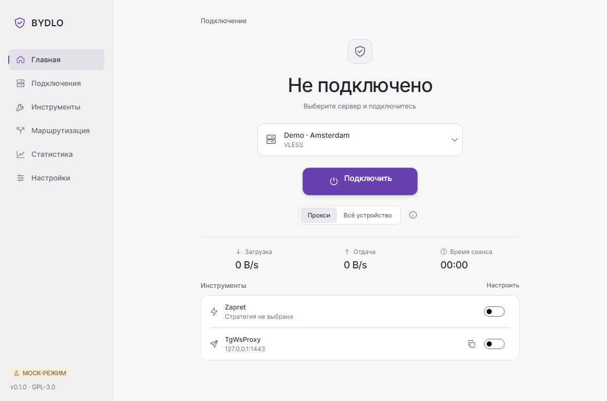
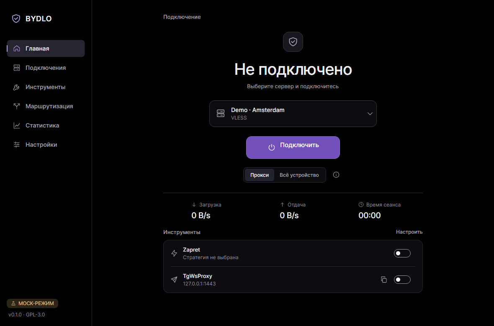
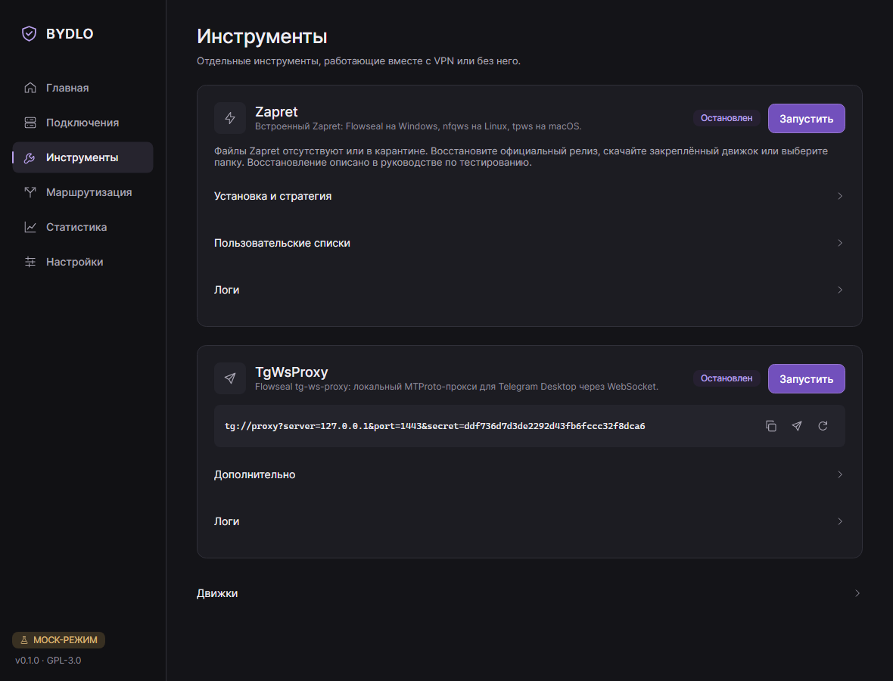
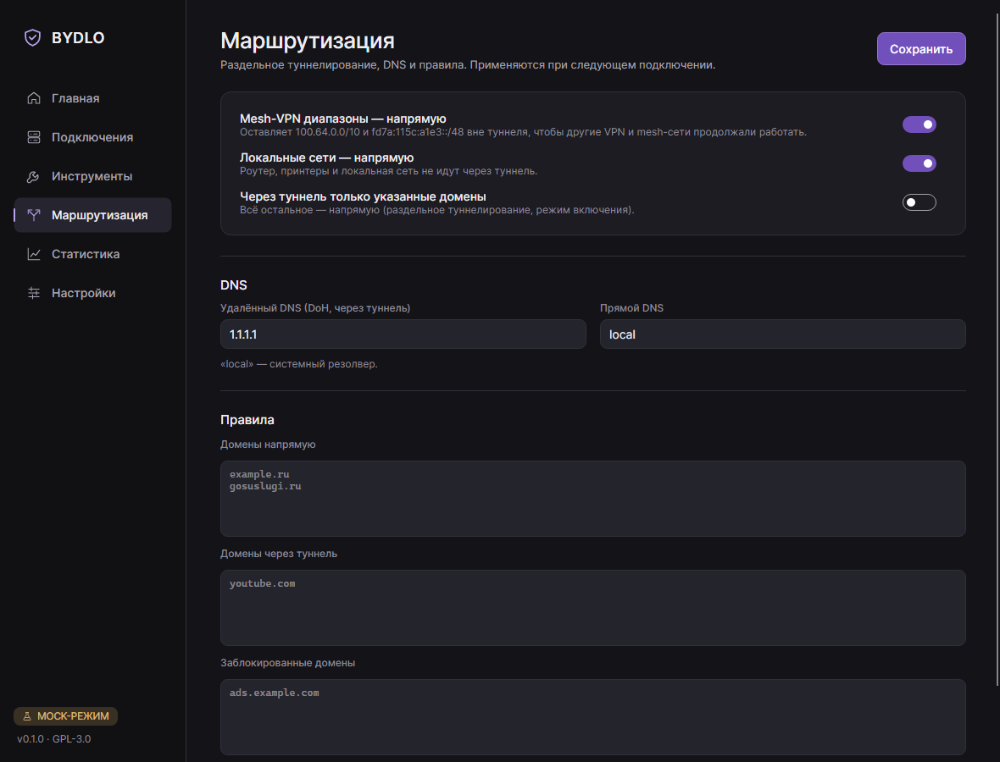
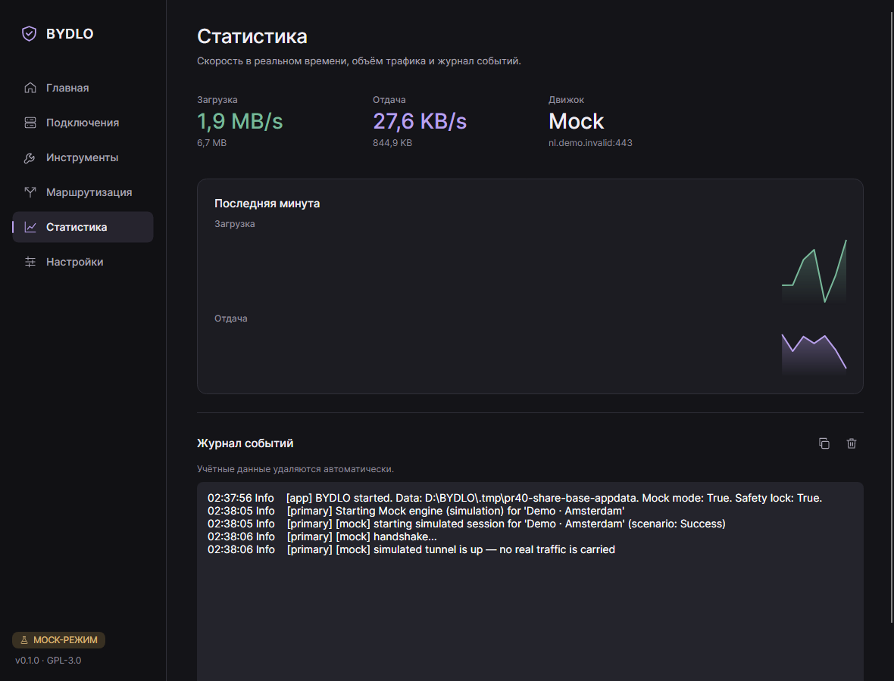
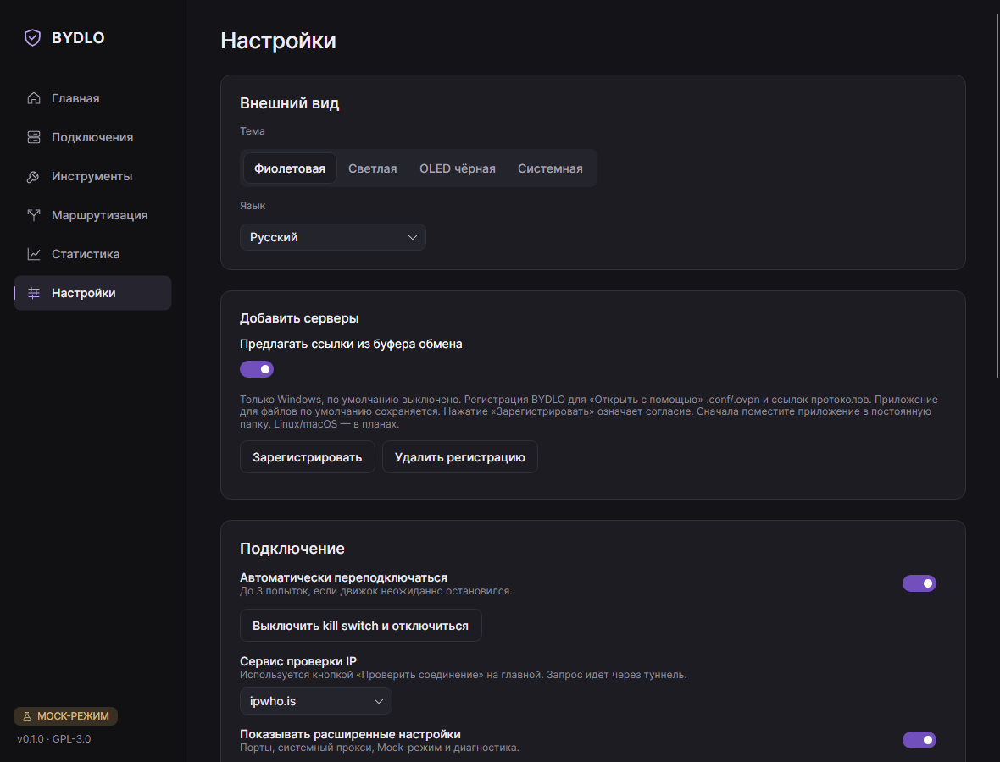
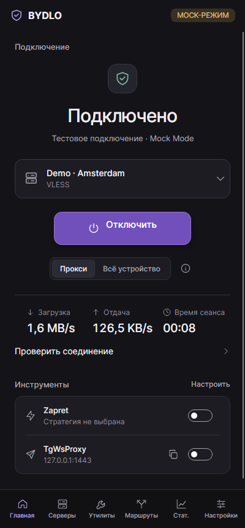

<p align="center"></p>

<h1 align="center">BYDLO</h1>
<p align="center"><b>B</b>ypass <b>Y</b>our <b>D</b>igital <b>L</b>imitations <b>O</b>nline<br>
<i>One app. Every protocol. Zero bullshit.</i></p>

<p align="center"></p>

BYDLO — бесплатный open-source лаунчер с графическим интерфейсом для VPN, прокси и инструментов свободного доступа к интернету.
Импортируйте ссылку, файл конфигурации, QR-код или подписку — и подключайтесь одной кнопкой.
BYDLO не изобретает протоколы заново: он управляет проверенными движками (sing-box, Xray-core, WireGuard,
AmneziaWG, OpenVPN), а также [Zapret](https://github.com/Flowseal/zapret-discord-youtube) и
[tg-ws-proxy](https://github.com/Flowseal/tg-ws-proxy) от Flowseal — через один понятный интерфейс.

> **Статус: v0.1 — первая публичная версия.** Приложение собирается, его логика покрыта изолированными тестами,
> а интерфейс можно опробовать в Mock-режиме. Реальные туннели авторы **ещё не проверили** на всех платформах —
> см. [docs/COMPATIBILITY.md](docs/COMPATIBILITY.md) и [docs/TESTING.md](docs/TESTING.md).

## Возможности

- **Подключение одной кнопкой**: заметная кнопка подключения, скорость в реальном времени и таймер сеанса.
- **Проверка соединения**: внешний IP, страна и задержка через туннель — по явному нажатию, с выбором сервиса проверки.
- **Протоколы:** VLESS (включая REALITY и XHTTP через Xray), VMess, Trojan, Shadowsocks, Hysteria 2, TUIC, SOCKS5, HTTP(S),
  WireGuard, AmneziaWG, OpenVPN.
- **Импорт:** ссылки (`vless://`, `vmess://`, `trojan://`, `ss://`, `hy2://`, `tuic://`, `socks5://`, `wireguard://`…),
  base64-подписки, `.conf` (WireGuard / AmneziaWG), `.ovpn`, изображения с QR-кодом.
- **Zapret из коробки:** Windows x64 — Flowseal; Linux x64/ARM64 — nfqws + nftables; macOS — tpws + PF (IPv4 TCP 80/443). На Windows стратегии Flowseal используются без изменений, `winws.exe` запускается без окна консоли;
  выбор стратегии, игровой фильтр, редактор пользовательских списков, логи, встроенная закреплённая версия с проверкой SHA-256 в CI; пользовательские списки переживают обновления.
- **TgWsProxy:** tg-ws-proxy от Flowseal без окна и трея, ссылка `tg://proxy` в один клик, управление секретом, контроль занятых портов.
- **Маршрутизация:** локальный прокси или режим всего устройства (TUN), раздельное туннелирование, DNS,
  списки «напрямую / через туннель / блокировать», диапазоны mesh-VPN остаются вне туннеля.
- **Безопасность:** секреты хранятся зашифрованными (DPAPI на Windows), учётные данные вырезаются из логов,
  восстановление после сбоев, проверка целостности загружаемых движков, привилегированные операции изолированы и выключены по умолчанию.
- **Дизайн:** фиолетовая (по умолчанию), светлая, чёрная OLED и системная темы; русский и английский языки;
  спокойные непрозрачные поверхности, адаптивная раскладка от ширины телефона до десктопа.
- **Mock-режим:** явно помеченная имитация подключения, трафика и ошибок для проверки интерфейса без запуска сетевых движков.

## Интерфейс

Фиолетовая, светлая и OLED-темы используют общую компоновку. На узком экране sidebar заменяется нижней навигацией.
Скриншоты сняты на русском языке в Mock Mode; подключение и трафик на них имитируются.

<p align="center">
  
  
</p>
<p align="center">
  
  
</p>
<p align="center">
  
  
</p>
<p align="center">
  
</p>
<p align="center">
  
  
</p>

## Платформы

| Платформа | v0.1 |
|---|---|
| Windows 10/11 x64, ARM64 | Собирается в CI; основная платформа разработки |
| Linux x64, ARM64 | Собирается в CI; встроенный nfqws, нужен root + nftables |
| macOS Intel, Apple Silicon | Собирается в CI (без подписи); встроенный tpws, только IPv4 TCP 80/443, нужен root |
| Android ARM64 | Запланирован (см. [roadmap](docs/ROADMAP.md)) |

Подробно по протоколам и платформам: [docs/COMPATIBILITY.md](docs/COMPATIBILITY.md).

## Быстрый старт (из исходников)

```bash
git clone https://github.com/endercodezz/BYDLO.git
cd BYDLO
source scripts/env.sh          # PowerShell: . ./scripts/env.ps1
dotnet run --project src/Bydlo.Desktop -- --mock   # интерфейс в Mock-режиме
```

Скрипты `scripts/env.*` держат все кэши внутри репозитория и включают блокировку разработки (`BYDLO_SAFE_DEV=1`),
поэтому реальные движки отказываются запускаться. Чтобы пользоваться BYDLO по-настоящему, запустите его из обычной
оболочки без этой переменной или возьмите сборку из CI / Releases. Подробнее — в [docs/BUILD.md](docs/BUILD.md).

## Документация

- [Импорт, буфер обмена и «Открыть с помощью»](docs/IMPORT.md)
- [Архитектура](docs/ARCHITECTURE.md)
- [Сборка](docs/BUILD.md)
- [Совместимость протоколов и платформ](docs/COMPATIBILITY.md)
- [Руководство по ручному тестированию](docs/TESTING.md)
- [Roadmap](docs/ROADMAP.md)
- [Сторонние компоненты и лицензии](THIRD_PARTY_NOTICES.md)
- [Правила для участников и агентов](CLAUDE.md) (на английском)

## Благодарности

BYDLO построен на работе этих проектов:
[Flowseal/zapret-discord-youtube](https://github.com/Flowseal/zapret-discord-youtube),
[bol-van/zapret](https://github.com/bol-van/zapret),
[Flowseal/tg-ws-proxy](https://github.com/Flowseal/tg-ws-proxy),
[SagerNet/sing-box](https://github.com/SagerNet/sing-box),
[XTLS/Xray-core](https://github.com/XTLS/Xray-core),
[WireGuard](https://www.wireguard.com),
[AmneziaWG](https://github.com/amnezia-vpn),
[OpenVPN](https://github.com/OpenVPN/openvpn),
[Avalonia UI](https://github.com/AvaloniaUI/Avalonia) и других, перечисленных в [THIRD_PARTY_NOTICES.md](THIRD_PARTY_NOTICES.md).
Спасибо им.

## Лицензия

BYDLO распространяется по [GNU General Public License v3.0 или более поздней](LICENSE).
Сторонние компоненты сохраняют свои лицензии — см. [THIRD_PARTY_NOTICES.md](THIRD_PARTY_NOTICES.md).

Используйте BYDLO в соответствии с законодательством вашей страны. Это клиент для сетей и серверов, которыми вы вправе пользоваться.
