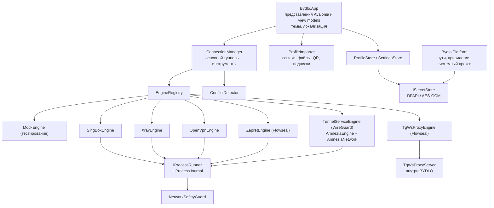

# Архитектура

BYDLO — приложение на .NET 10 и Avalonia 11. Интерфейс никогда не работает с процессами или сетью напрямую — всё
проходит через единый `ConnectionManager` и подключаемые адаптеры движков.

## Проекты

| Проект | Ответственность |
|---|---|
| `src/Bydlo.Core` | Модели (`Profile`, `AppSettings`), парсеры импорта, генераторы конфигураций sing-box / Xray, контракты движков, `ProcessEngineBase`, `MockEngine`, `ConnectionManager`, `ConflictDetector`, `LogHub` с очисткой секретов, `NetworkSafetyGuard`, `IntegrityVerifier`, запуск процессов и журнал процессов, JSON-хранилища. Без UI и без платформенного кода. |
| `src/Bydlo.Engines` | Реальные адаптеры, поиск движков, установщик закреплённых версий (`engines.lock.json`), парсер стратегий Zapret, работа с установкой и обновлением Zapret, среда TgWsProxy и генератор ссылок. |
| `src/Bydlo.Platform` | Каталоги данных для каждой ОС, хранилища секретов, определение прав администратора и повышение прав, системный прокси Windows. |
| `src/Bydlo.App` | Интерфейс на Avalonia: оболочка, шесть страниц, темы, иконки, локализация, распознавание QR. Общий для всех хостов. |
| `src/Bydlo.Desktop` | Исполняемый файл для Windows / Linux / macOS. |
| `tests/Bydlo.Tests` | Изолированные модульные тесты (фейковый запуск процессов, фейковый HTTP, временные каталоги). |
| `tools/Bydlo.Screenshots` | Отрисовка всех страниц в Mock-режиме без окна (для документации и визуальной проверки). |

## Ключевые понятия

**Профиль и секреты.** `Profile` хранит только несекретные параметры (хост, порт, SNI, транспорт, публичный ключ REALITY…).
UUID, пароли, приватные ключи и исходные конфигурации WireGuard/OpenVPN попадают в `ISecretStore` под идентификатором профиля.
На Windows используется DPAPI (текущий пользователь); на других системах — AES-256-GCM с ключевым файлом, доступным
только владельцу (Keychain / libsecret — в roadmap).

**Движки.** `IEngine` — это проверка доступности, запуск и остановка, а также события состояния, логов и трафика.
Большинство адаптеров наследуют `ProcessEngineBase`: он записывает сгенерированную конфигурацию, запускает процесс через
`IProcessRunner`, ждёт строку о готовности, превращает фатальный вывод в понятные ошибки и сообщает о неожиданном
завершении. `EngineRegistry` выбирает лучший движок для профиля (сначала sing-box; Xray для XHTTP; встроенные процессы для
AmneziaWG / OpenVPN) и предлагает только движки, у которых в `EngineDescriptor` текущая ОС отмечена как реализованная.

**Менеджер подключений.** Один основной туннель плюс независимые сеансы инструментов (Zapret, TgWsProxy). Перед запуском
работает `ConflictDetector` (занятые порты, совпадение порта TgWsProxy и локального прокси, Zapret вместе с TUN,
диапазоны mesh-VPN). При сбое выполняется до трёх попыток переподключения с экспоненциальной задержкой; при отключении
восстанавливается системный прокси.

**Восстановление после сбоев.** `ProcessJournal` записывает PID запущенных движков. При следующем запуске BYDLO находит
процессы, у которых совпадают имя образа и время запуска, и предлагает их остановить.

**Запуск без окон.** Внешние движки и вспомогательные команды проходят через `SystemProcessRunner`:
`UseShellExecute=false`, `CreateNoWindow=true`, перенаправление stdin/stdout/stderr.
sing-box, Xray, AmneziaWG и OpenVPN не запускают собственные GUI; Zapret запускает бинарник
напрямую по разобранным аргументам, без исполнения BAT/shell-стратегий. TgWsProxy не создаёт
отдельного процесса. Запрос повышения прав — отдельный явный перезапуск самого BYDLO,
а не фоновая привилегированная служба.

**Разделение привилегий.** BYDLO работает от обычного пользователя (`asInvoker`). Операции, меняющие систему, — режим TUN,
туннельные службы WireGuard, адаптер AmneziaWG, маршруты OpenVPN, WinDivert (Zapret), системный прокси — требуют повышения прав,
которое пользователь даёт явно (Настройки → Перезапустить от администратора), выключены по умолчанию и отклоняются, пока
установлена `BYDLO_SAFE_DEV=1`. Адресами, маршрутами и DNS выделенного адаптера AmneziaWG управляет
`IAmneziaNetwork`; временными правилами Zapret — `IZapretFirewall`. Обе службы используют guarded `IProcessRunner`.

**Встроенные движки.** `EngineLocator` ищет явный путь из настроек, затем закреплённую копию рядом с приложением,
управляемую установку и PATH. `AmneziaEngine` пишет защищённую UAPI-конфигурацию для минимального Go-хоста,
который использует неизменённый upstream `amneziawg-go`. До туннельных маршрутов сохраняется маршрут к серверу;
состояние выделенного адаптера и маршрутов записывается в `amnezia-network.json`. Повторная очистка проверяет
идентификатор адаптера, ошибки сохраняют журнал. Хост выходит при закрытии stdin/завершении родителя.
OpenVPN на Windows получает собственный exit event для штатной очистки, в том числе при восстановлении по журналу
процессов; на Unix используется SIGTERM. `OpenVpnDriver` — отдельная операция по явному согласию, никогда не вызывается
проверкой доступности или подключением. В сборке извлекаются только движок/DLL/tapctl/DCO, без GUI и служб.

**Zapret.** BYDLO не переписывает стратегии Flowseal. `ZapretStrategyParser` читает `general*.bat`, склеивает строки с
переносом `^`, извлекает командную строку `winws.exe` и подставляет `%BIN%`, `%LISTS%` и переменные игрового фильтра
точно так же, как `service.bat`. Затем `winws.exe` запускается напрямую (без окна консоли, вывод перехватывается).
Пользовательские списки создаются со значениями по умолчанию от Flowseal и сохраняются при обновлениях. Необязательная
настройка TCP timestamps (`netsh`), которую рекомендует Flowseal, показывается как совет и никогда не применяется автоматически.

**TgWsProxy.** Ядро Flowseal tg-ws-proxy перенесено на C# (`src/Bydlo.Engines/TgWsProxy`) и работает внутри BYDLO,
без Python и внешних процессов. Это ретранслятор, а не VPN-протокол: прокси принимает MTProto-соединения Telegram
(obfuscated2, AES-CTR), перешифровывает их и отправляет через WebSocket-шлюз Telegram (`kws*.web.telegram.org/apiws`).
Если WebSocket недоступен — резервный путь через домены Cloudflare, затем прямой TCP к DC. Поддерживаются пул
WebSocket-соединений, домен-фронтинг, Fake TLS (`ee`-секрет) с маскировкой под указанный сайт. Каждое WebSocket-соединение
читается фоновым циклом с момента подключения: простаивающее соединение в пуле отвечает на ping, а закрытое сервером
сразу выбрасывается из пула и не достаётся клиенту. Если слушающий сокет «умирает» (например, после сна системы), прокси
заново занимает порт (до трёх попыток с интервалом 1 с) и только потом сообщает об ошибке. Все сетевые операции, включая
слушатель, идут через `ITgNetwork`; реализация по умолчанию проверяет `NetworkSafetyGuard`, а тесты подменяют её
потоками в памяти.
Ссылки строятся так же, как в оригинале (`dd` + секрет, или `ee` + секрет + hex(домен) для Fake TLS).
Мультиплексирование медиа через HTTP/2 (`cf_h2` в оригинале) пока не перенесено: медиа идёт по тому же резервному
WebSocket-пути, как с флагом `--no-h2`.

**Mock-режим.** `MockEngine` имитирует подключение, трафик, ошибки подключения, сбои и медленное подключение, не запуская
ни одного процесса. Включается флагом `--mock`, переменной `BYDLO_MOCK=1` или в Настройки → Дополнительно; интерфейс
показывает значок «MOCK-РЕЖИМ».

**Целостность.** `engines/engines.lock.json` закрепляет версии и SHA-256, опубликованные GitHub для каждого файла релиза.
`EngineInstaller` проверяет хеш до распаковки и блокирует выход путей за пределы каталога в архивах.

**Логи.** Весь вывод движков проходит через `LogRedactor` (учётные данные в URI, `password=`, UUID, ключи WireGuard,
секреты MTProto, а также все секреты активного профиля) ровно один раз до того, как попасть в интерфейс
или `logs/bydlo.log`: строки движков маскируются в самом движке (в том числе внутри привилегированной службы,
где известны секреты её сессии), а `LogHub` сохраняет их без повторного прохода. Файл пишет фоновая задача через `Channel<T>` с постоянным
`FileStream` и ротацией при 2 МБ, а интерфейс получает не отдельный вызов на строку, а пакет раз в 150 мс.

**Нативный Zapret.** Общий `ZapretEngine` управляет состоянием/списками/логами; `WinDivertBackend`, `NfqueueBackend`, `PfTpwsBackend` возвращают единую `ParsedStrategy` с аргументами, не запускают shell. Приоритет: исправная встроенная копия → управляемая → пользовательская. Списки пользователя — `<data>/zapret/lists/`, пути подставляются отдельно от read-only ресурсов релиза.

`ZapretFirewall` в Platform генерирует только собственную nftables-таблицу или PF-anchor, проверяет синтаксис и сохраняет типизированный журнал **до** применения. Очистка выполняется при остановке, ошибке запуска, Dispose и неожиданном завершении дочернего процесса. После сбоя приложения журнал восстанавливается при следующем запуске с root вне Mock/Safe Dev. Ошибка очистки сохраняет журнал. Эксклюзивный файловый lock не позволяет второму экземпляру снять активные правила первого. В журнале нет произвольных shell-команд; scope строго валидируется.
