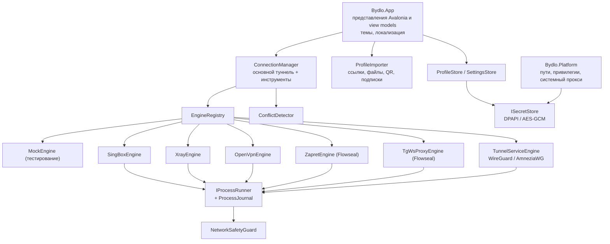

# Архитектура

BYDLO — приложение на .NET 10 и Avalonia 11. Интерфейс никогда не работает с процессами или сетью напрямую — всё
проходит через единый `ConnectionManager` и подключаемые адаптеры движков.

## Проекты

| Проект | Ответственность |
|---|---|
| `src/Bydlo.Core` | Модели (`Profile`, `AppSettings`), парсеры импорта, генераторы конфигураций sing-box / Xray, контракты движков, `ProcessEngineBase`, `MockEngine`, `ConnectionManager`, `ConflictDetector`, `LogHub` с очисткой секретов, `NetworkSafetyGuard`, `IntegrityVerifier`, запуск процессов и журнал процессов, JSON-хранилища. Без UI и без платформенного кода. |
| `src/Bydlo.Engines` | Реальные адаптеры, поиск движков, установщик закреплённых версий (`engines.lock.json`), парсер стратегий Zapret, работа с установкой и обновлением Zapret, среда TgWsProxy и генератор ссылок. |
| `src/Bydlo.Platform` | Каталоги данных для каждой ОС, хранилища секретов, определение прав администратора и повышение прав, системный прокси Windows. |
| `src/Bydlo.App` | Интерфейс на Avalonia: оболочка, шесть страниц, темы, иконки, локализация, распознавание QR. Общий для всех хостов. |
| `src/Bydlo.Desktop` | Исполняемый файл для Windows / Linux / macOS. |
| `tests/Bydlo.Tests` | Изолированные модульные тесты (фейковый запуск процессов, фейковый HTTP, временные каталоги). |
| `tools/Bydlo.Screenshots` | Отрисовка всех страниц в Mock-режиме без окна (для документации и визуальной проверки). |

## Ключевые понятия

**Профиль и секреты.** `Profile` хранит только несекретные параметры (хост, порт, SNI, транспорт, публичный ключ REALITY…).
UUID, пароли, приватные ключи и исходные конфигурации WireGuard/OpenVPN попадают в `ISecretStore` под идентификатором профиля.
На Windows используется DPAPI (текущий пользователь); на других системах — AES-256-GCM с ключевым файлом, доступным
только владельцу (Keychain / libsecret — в roadmap).

**Движки.** `IEngine` — это проверка доступности, запуск и остановка, а также события состояния, логов и трафика.
Большинство адаптеров наследуют `ProcessEngineBase`: он записывает сгенерированную конфигурацию, запускает процесс через
`IProcessRunner`, ждёт строку о готовности, превращает фатальный вывод в понятные ошибки и сообщает о неожиданном
завершении. `EngineRegistry` выбирает лучший движок для профиля (сначала sing-box; Xray для XHTTP; нативные клиенты для
AmneziaWG / OpenVPN) и предлагает только движки, у которых в `EngineDescriptor` текущая ОС отмечена как реализованная.

**Менеджер подключений.** Один основной туннель плюс независимые сеансы инструментов (Zapret, TgWsProxy). Перед запуском
работает `ConflictDetector` (занятые порты, совпадение порта TgWsProxy и локального прокси, Zapret вместе с TUN,
диапазоны mesh-VPN). При сбое выполняется до трёх попыток переподключения с экспоненциальной задержкой; при отключении
восстанавливается системный прокси.

**Восстановление после сбоев.** `ProcessJournal` записывает PID запущенных движков. При следующем запуске BYDLO находит
процессы, у которых совпадают имя образа и время запуска, и предлагает их остановить.

**Разделение привилегий.** BYDLO работает от обычного пользователя (`asInvoker`). Операции, меняющие систему, — режим TUN,
туннельные службы WireGuard/AmneziaWG, маршруты OpenVPN, WinDivert (Zapret), системный прокси — требуют повышения прав,
которое пользователь даёт явно (Настройки → Перезапустить от администратора), выключены по умолчанию и отклоняются, пока
установлена `BYDLO_SAFE_DEV=1`. Сам BYDLO никогда не меняет DNS, маршруты и firewall; это делают движки и только на время подключения.

**Zapret.** BYDLO не переписывает стратегии Flowseal. `ZapretStrategyParser` читает `general*.bat`, склеивает строки с
переносом `^`, извлекает командную строку `winws.exe` и подставляет `%BIN%`, `%LISTS%` и переменные игрового фильтра
точно так же, как `service.bat`. Затем `winws.exe` запускается напрямую (без окна консоли, вывод перехватывается).
Пользовательские списки создаются со значениями по умолчанию от Flowseal и сохраняются при обновлениях. Необязательная
настройка TCP timestamps (`netsh`), которую рекомендует Flowseal, показывается как совет и никогда не применяется автоматически.

**TgWsProxy.** Релизные бинарники Flowseal — это приложения для трея, поэтому BYDLO запускает консольную точку входа
пакета (`tg-ws-proxy`) из отдельного окружения Python, созданного из закреплённого тега, либо указанный пользователем
исполняемый файл. Ссылки строятся так же, как в оригинале (`dd` + секрет, или `ee` + секрет + hex(домен) для Fake TLS).

**Mock-режим.** `MockEngine` имитирует подключение, трафик, ошибки подключения, сбои и медленное подключение, не запуская
ни одного процесса. Включается флагом `--mock`, переменной `BYDLO_MOCK=1` или в Настройки → Дополнительно; интерфейс
показывает значок «MOCK-РЕЖИМ».

**Целостность.** `engines/engines.lock.json` закрепляет версии и SHA-256, опубликованные GitHub для каждого файла релиза.
`EngineInstaller` проверяет хеш до распаковки и блокирует выход путей за пределы каталога в архивах.

**Логи.** Весь вывод движков проходит через `LogRedactor` (учётные данные в URI, `password=`, UUID, ключи WireGuard,
секреты MTProto, а также все секреты активного профиля) до того, как попасть в интерфейс или `logs/bydlo.log`.
