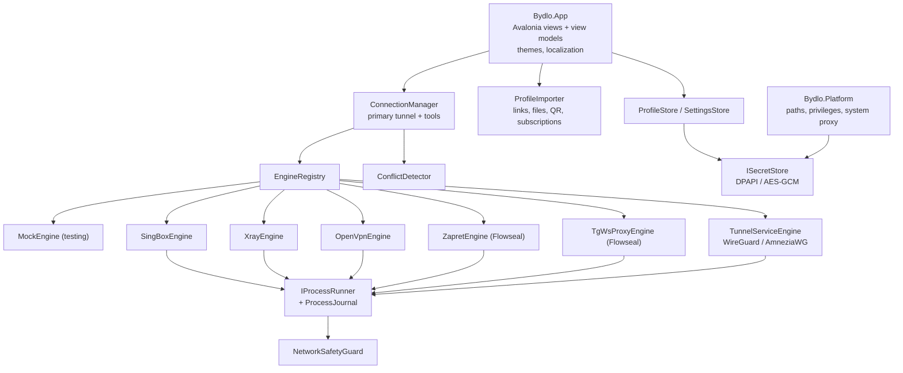

# Architecture

BYDLO is a .NET 10 / Avalonia 11 application. The UI never touches processes or the network directly — everything
goes through one `ConnectionManager` and pluggable engine adapters.

## Projects

| Project | Responsibility |
|---|---|
| `src/Bydlo.Core` | Models (`Profile`, `AppSettings`), import parsers, sing-box / Xray config builders, engine contracts, `ProcessEngineBase`, `MockEngine`, `ConnectionManager`, `ConflictDetector`, redacting `LogHub`, `NetworkSafetyGuard`, `IntegrityVerifier`, process runner + journal, JSON stores. No UI, no platform code. |
| `src/Bydlo.Engines` | Real adapters, engine locator, pinned engine installer (`engines.lock.json`), Zapret strategy parser / installation / updater, TgWsProxy runtime + link builder. |
| `src/Bydlo.Platform` | Data folders per OS, secret stores, administrator detection / elevation, Windows system proxy. |
| `src/Bydlo.App` | Avalonia UI: shell, six pages, themes, icons, localization, QR decoding. Shared by every head. |
| `src/Bydlo.Desktop` | Windows / Linux / macOS host executable. |
| `tests/Bydlo.Tests` | Isolated unit tests (fake process runner, fake HTTP, temp dirs). |
| `tools/Bydlo.Screenshots` | Headless renderer of all pages in Mock Mode (docs, visual review). |

## Key concepts

**Profile and secrets.** A `Profile` stores only non-secret options (host, port, SNI, transport, REALITY public key…).
UUIDs, passwords, private keys and raw WireGuard/OpenVPN configs go to `ISecretStore` under the profile id.
Windows uses DPAPI (current user); other systems use AES-256-GCM with an owner-only key file (Keychain / libsecret
are on the roadmap).

**Engines.** `IEngine` = availability check + start/stop + state, log and traffic events. Most adapters derive from
`ProcessEngineBase`, which writes the generated config, launches the process through `IProcessRunner`, waits for a
readiness line, maps fatal output to readable errors and reports unexpected exits. `EngineRegistry` picks the best engine
for a profile (sing-box first; Xray for XHTTP; native clients for AmneziaWG / OpenVPN) and only offers engines whose
`EngineDescriptor` marks the current OS as implemented.

**Connection manager.** One primary tunnel plus independent tool sessions (Zapret, TgWsProxy). Before starting it runs
`ConflictDetector` (busy ports, TgWsProxy vs. local proxy port, Zapret + TUN, mesh-VPN ranges). It auto-reconnects up to
three times with exponential back-off and restores the system proxy on disconnect.

**Crash recovery.** `ProcessJournal` records PIDs of started engines. On the next start BYDLO detects processes that
still match the recorded image name and start time and offers to stop them.

**Privilege separation.** BYDLO runs as a normal user (`asInvoker`). Operations that change the system — TUN mode,
WireGuard/AmneziaWG tunnel services, OpenVPN routes, WinDivert (Zapret), system proxy — require elevation that the user
grants explicitly (Settings → Restart as administrator), are disabled by default and are refused while
`BYDLO_SAFE_DEV=1` is set. BYDLO never modifies DNS, routes or firewall itself; engines do so only while connected.

**Zapret.** BYDLO does not rewrite Flowseal's strategies. `ZapretStrategyParser` reads a `general*.bat`, joins `^`
continuations, extracts the `winws.exe` command line and substitutes `%BIN%`, `%LISTS%` and the game-filter variables
exactly like `service.bat`. `winws.exe` is then started directly (no console window, output captured). User lists are
created with Flowseal's defaults and preserved across updates. Flowseal's optional TCP-timestamps tweak (`netsh`) is shown
as advice and never applied automatically.

**TgWsProxy.** Flowseal's release binaries are tray apps, so BYDLO runs the package's headless CLI (`tg-ws-proxy`)
from a private virtualenv created from the pinned tag, or a user-provided executable. Links are built exactly like
upstream (`dd` + secret, or `ee` + secret + hex(domain) for Fake TLS).

**Mock Mode.** `MockEngine` simulates connect, traffic, connect failures, crashes and slow connects without starting any
process. It is enabled by `--mock`, `BYDLO_MOCK=1` or Settings → Advanced, and the UI shows a "MOCK MODE" badge.

**Integrity.** `engines/engines.lock.json` pins versions and the SHA-256 digests published by GitHub for each asset.
`EngineInstaller` verifies the hash before extraction and blocks path traversal in archives.

**Logs.** All engine output passes through `LogRedactor` (URI credentials, `password=`, UUIDs, WireGuard keys,
MTProto secrets, plus every secret of the active profile) before reaching the UI or `logs/bydlo.log`.
