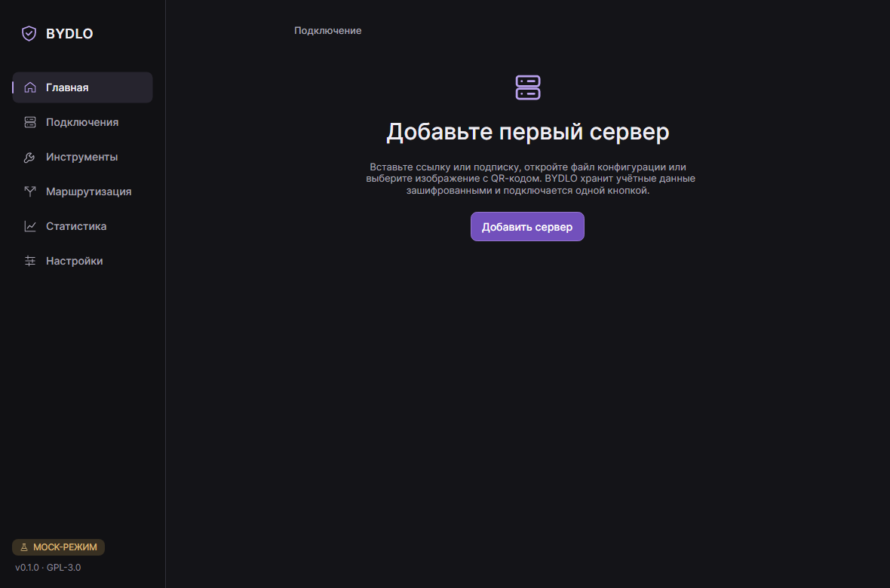
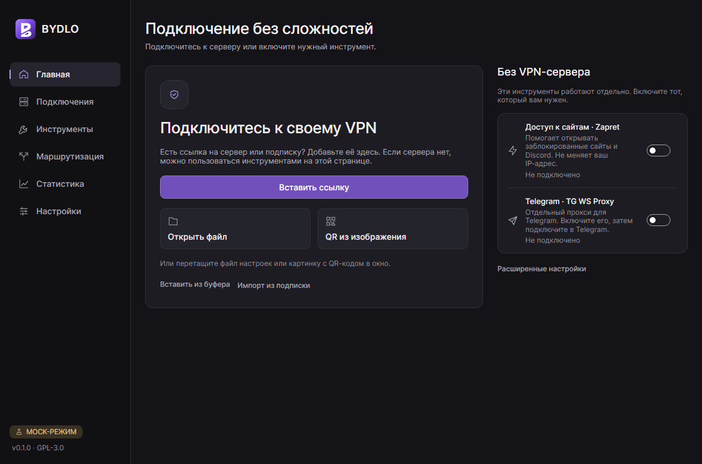
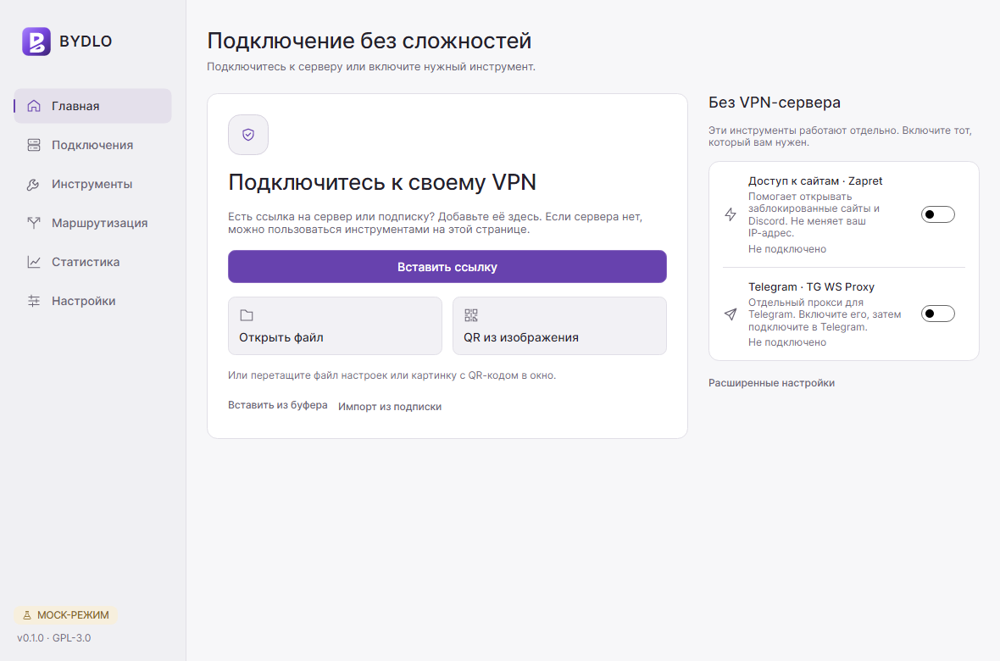
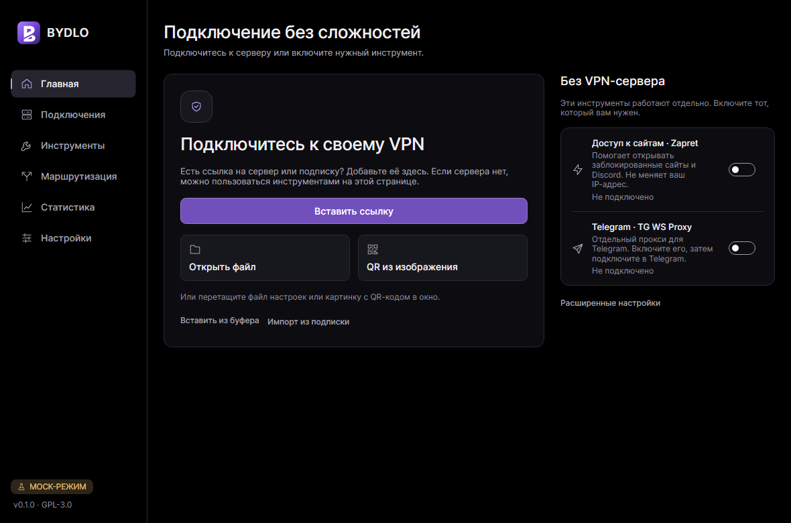
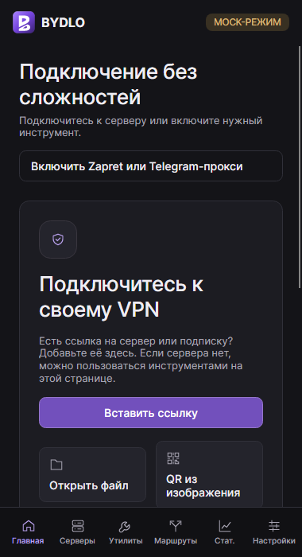
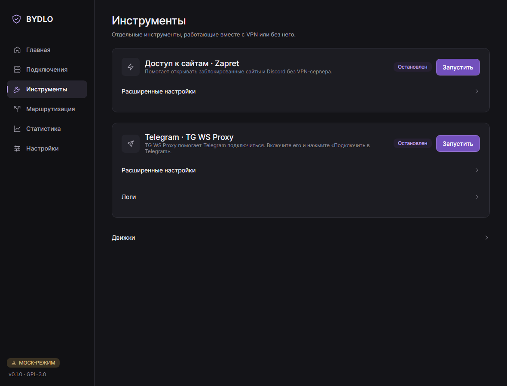
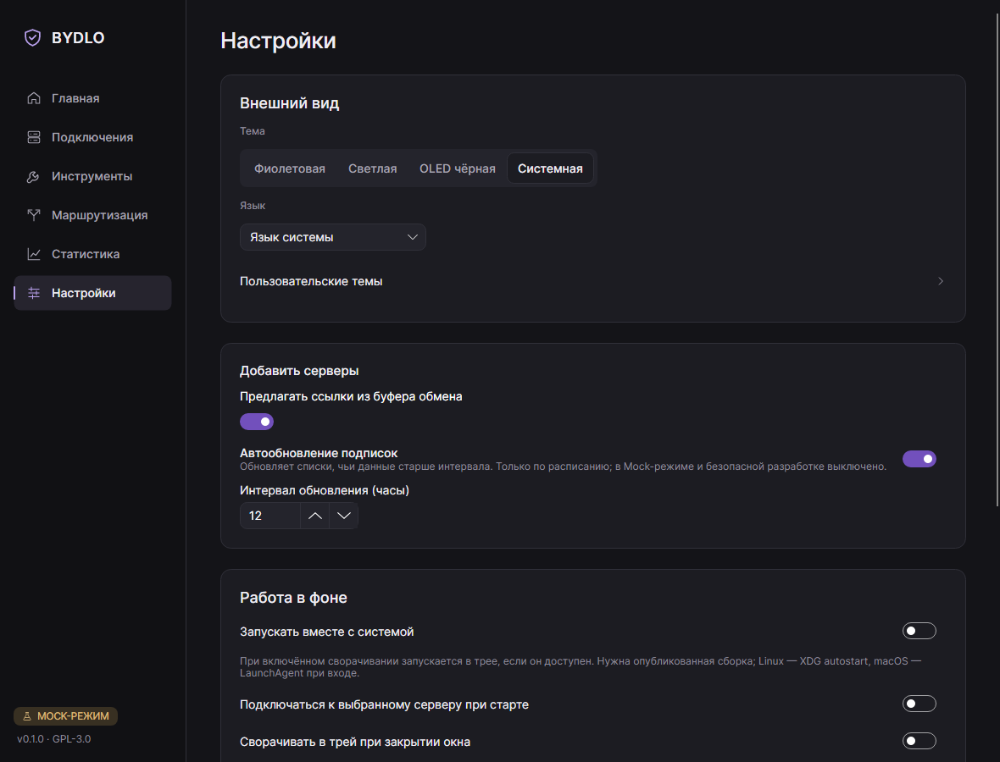

# Подключение без сложностей

На главной есть два независимых способа начать работу:

- **Свой VPN.** Вставьте ссылку на сервер или подписку, откройте файл настроек
  либо изображение с QR-кодом. Мастер покажет предпросмотр перед сохранением.
  Файл также можно перетащить в окно. После добавления выберите сервер и нажмите
  «Подключить».
- **Без VPN-сервера.** Включите переключатель «Доступ к сайтам · Zapret»
  или нажмите «Открыть в Telegram» в карточке «Telegram · TG WS Proxy».
  Они доступны и в пустом приложении. Zapret не меняет IP-адрес.
  Кнопка Telegram запускает прокси и сразу открывает штатное окно подключения
  в Telegram — подтвердите подключение там. Повторное нажатие открывает ссылку
  работающего прокси без перезапуска. Состояние и кнопка «Остановить» видны
  в карточке; такой же способ подключения есть в инструментах.

В узком окне карточки идут друг под другом. Кнопка «Включить Zapret или
Telegram-прокси» вверху главной сразу открывает инструменты.

В настройках сначала показаны тема, язык, импорт, автозапуск, уведомления
и восстановление подключения. Порты, системный прокси, доступ из локальной сети,
тестовый режим и диагностика находятся в «Расширенных настройках».
В инструментах такая же кнопка раскрывает стратегии Zapret, списки и параметры
Telegram-прокси. [Ограничения платформ](COMPATIBILITY.md) сохраняются.

В левом нижнем углу бокового меню есть пункт «Участники». Он открывает отдельную вкладку
со списком участников проекта и числом их коммитов; кнопка у каждого открывает профиль на GitHub.
Список не зашит в приложение: он берётся из GitHub API (`repos/endercodezz/BYDLO/contributors`),
боты отфильтрованы. Загрузка идёт вместе с автоматической проверкой обновлений — не чаще раза
в сутки и только если проверка включена; в Mock-режиме и с `BYDLO_SAFE_DEV` запросов нет.
Последний список сохраняется в настройках и показывается без сети. В узком окне вкладка
открывается из «Настройки → О приложении».

Над интерфейсом может появиться плашка с объявлением от разработчиков, например о скором релизе
с исправлениями. Текст берётся из файла `notice.json` в репозитории при каждом запуске, если
включена автоматическая проверка обновлений; в Mock-режиме и с `BYDLO_SAFE_DEV` запросов нет.
Закрытое объявление больше не показывается. Как его опубликовать — [NOTICE.md](NOTICE.md).

Приложение использует единый новый логотип: белую букву B с диагональным разрезом
на фиолетовой плитке. Он показан в боковом меню, компактной шапке, разделе
«О приложении», у окна и в трее. Иконка Windows содержит девять размеров
от 16 до 256 пикселей; все варианты созданы из общего векторного рисунка.

## Сравнение главной (#92)

Снимки сделаны на русском языке, с принудительным Mock-режимом и блокировкой
реальных сетевых операций. «До» — состояние ветки `release/v0.2-v0.3`
на коммите `5f486f0`, «после» — обновлённый интерфейс. Движки и трафик имитируются.

### До

### После

### Светлая и чёрная темы

### Узкое окно, 380 пикселей

### Инструменты и настройки

Порядок воспроизведения проверки: [TESTING.md](TESTING.md#простой-интерфейс-92).
